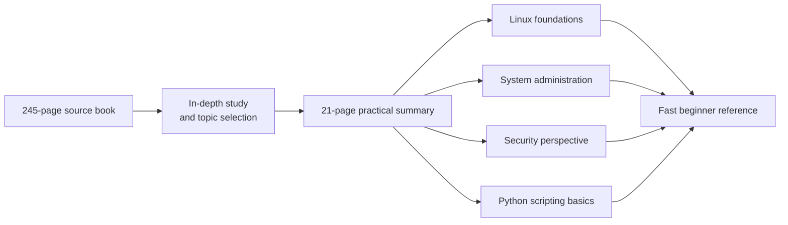
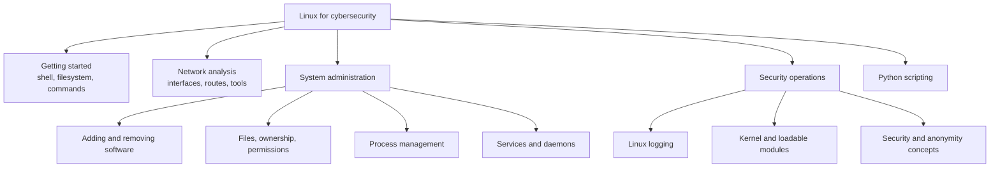

# Linux Basics for Hackers, 2nd Edition - Practical Summary

**A 21-page cybersecurity-focused study reference created by Ahmad Araja (ARAJAA).**

This repository contains my independent summary of *Linux Basics for Hackers, 2nd Edition*. I condensed the original 245-page learning journey into a focused 21-page A4 reference covering the Linux concepts most useful to beginners entering cybersecurity and penetration testing.

> This is an unofficial study resource. It is not affiliated with or endorsed by the book's author or publisher, and it does not replace the original book.

## Project at a glance



## Read the summary

**[Open or download the 21-page PDF](<Summary of Linux Basics for Hackers 2nd Edition.pdf>)**

The PDF is formatted as an A4 visual reference for quick review.

## Topics covered



- Getting started with Linux basics
- Analyzing and managing networks
- Adding and removing software
- Controlling file and directory permissions
- Managing processes
- Using and understanding services
- Working with Linux logs
- Understanding the kernel and loadable kernel modules
- Security and anonymity concepts
- Python scripting basics for hackers

## Who this is for

- Cybersecurity students starting with Linux
- Beginner penetration testers
- CTF learners who need a fast Linux refresher
- Readers of the original book who want concise revision notes

## Repository contents

```text
.
|-- Summary of Linux Basics for Hackers 2nd Edition.pdf
|-- README.md
`-- thank you.md
```

## Suggested use

1. Study the corresponding topic in the original book.
2. Use this PDF to review commands and core ideas.
3. Reproduce concepts in a legal lab or local Linux virtual machine.
4. Keep your own notes for commands and behavior observed during practice.

## Author

Created by **Ahmad Araja (ARAJAA)** as part of my cybersecurity and cloud-computing learning journey.

[Connect with me on LinkedIn](https://www.linkedin.com/in/ahmadaraja)

## Educational notice

Use security-related commands only in systems you own, CTF environments, training labs, or systems for which you have explicit authorization.
